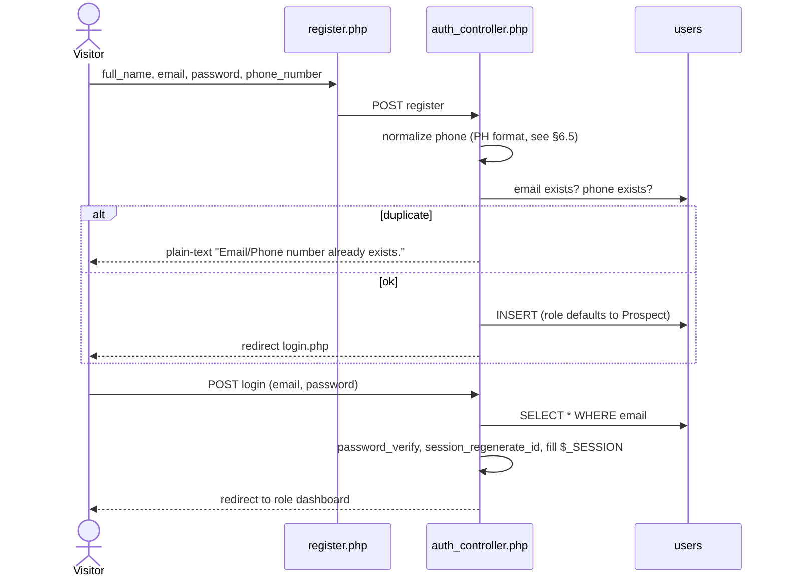
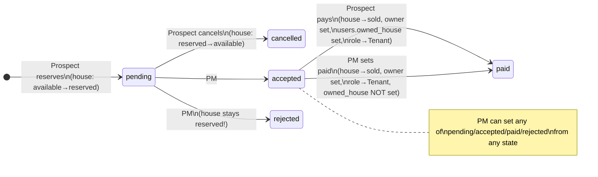
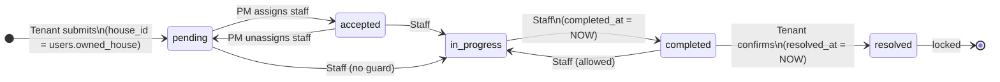
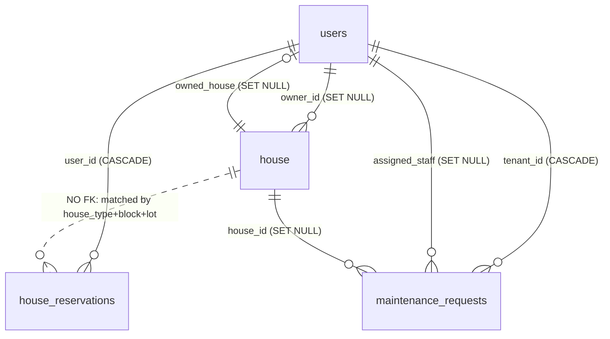

# Luminest — System Documentation & Laravel Rebuild Guide

> Scope: this documents the **current** plain-PHP implementation (branch `main` at commit `4d464db`) so it can be rebuilt in Laravel.
> Every rule below was read from the code, not from the UI or the `.docx` explainers. Where the code and the apparent intent disagree, both are noted (see [§7 Known defects](#7-known-defects-to-fix-not-port)).

---

## Table of contents

1. [System overview](#1-system-overview)
2. [Tech stack & project layout](#2-tech-stack--project-layout)
3. [Roles & access](#3-roles--access)
4. [Workflows](#4-workflows)
5. [Database](#5-database)
6. [Functions & endpoints reference](#6-functions--endpoints-reference)
7. [Known defects to fix, not port](#7-known-defects-to-fix-not-port)
8. [Laravel rebuild blueprint](#8-laravel-rebuild-blueprint)
9. [Data migration checklist](#9-data-migration-checklist)

---

## 1. System overview

Luminest is a real-estate management system for a single subdivision (15 blocks, 870 house units, 4 house models). It covers three business processes:

| Process | Actors | Summary |
|---|---|---|
| **House reservation & purchase** | Prospect, Property Manager | Prospect reserves a unit (block/lot) → PM accepts/rejects → Prospect "pays" → unit is sold, Prospect becomes Tenant. |
| **Maintenance requests** | Tenant, Property Manager, Maintenance Staff | Tenant files a request → PM assigns staff (expertise-matched) → staff works and completes it → Tenant confirms it as resolved. |
| **User administration** | Admin | CRUD on all user accounts, including role and staff expertise. |

There is no real payment gateway — "Pay Now" immediately marks the reservation paid.

---

## 2. Tech stack & project layout

| Concern | Current implementation |
|---|---|
| Language | PHP (procedural scripts + a few classes), no framework |
| DB | MySQL via PDO (`database/db.php`) |
| Migrations/seeds | Phinx (`phinx.php`, `db/migrations`, `db/seeds`) — the only Composer dependency |
| Frontend | Bootstrap 5 (CDN), jQuery `$.ajax` (Admin/Tenant/Prospect), vanilla `fetch` (Property Manager), Font Awesome / Bootstrap Icons |
| Auth | Native PHP `$_SESSION`, `password_hash`/`password_verify` (bcrypt) |
| Routing | None — each `.php` file is a URL. Hard-coded to be served under `/luminest/` (`$_SERVER['DOCUMENT_ROOT'] . '/luminest/...'`) |

```
index.php                 Redirects to welcome.php or view/dashboard.php (latter does not exist)
welcome.php               Public marketing landing page (static, placeholder listings)
database/db.php           Database/AppDatabase class; also instantiates global $pdo/$conn on include
controllers/
  BaseController.php      Extends AppDatabase, exposes getDbConnection()
  auth/auth_controller.php        Login, register, global "must be logged in" guard
  auth/profile_controller.php     Update profile, change password
  auth/reservation_controller.php Reserve, cancel, pay (Prospect)
  admin/admin_controller.php      Create/update/delete users (Admin)
  maintenance/*                   Tenant + Staff + PM maintenance logic
models/                   User, Admin, House, Maintenance (all extend Database → each opens its own PDO connection)
view/<Role>/*.php         Pages per role. Property_Manager pages contain their own SQL + AJAX handlers inline
view/house_types/*.php    Static detail pages for the 4 house models
view/layout/              header.php (includes auth_controller → acts as auth guard), navbar.php, footer.php
assets/                   Images, auth page CSS (luminest.php), PM maintenance JS
db/migrations, db/seeds   Phinx schema + seed data
tmp_debug_*.php, *.docx, generate_property_manager_docx.py   Debug/explainer leftovers — do not port
```

Config inconsistency: `database/db.php` connects on port **3306**, `phinx.php` on **3309**. Both use `root` with an empty password, committed to the repo.

---

## 3. Roles & access

Stored in `users.role` (enum). Session keys set at login: `user_id`, `email`, `username` (= full_name), `role`, `phone_number`, `expertise`, `owned_house`.

| Role | Landing page | Can do |
|---|---|---|
| `Prospect` (default on register) | `view/Prospect/dashboard.php` | Browse house models, reserve a unit, cancel pending reservation, pay accepted reservation, view reservation history |
| `Tenant` | `view/Tenant/dashboard.php` | File maintenance requests, view own requests, mark completed request as resolved, edit profile |
| `Maintenance_Staff` | `view/Maintenance_Staff/dashboard.php` | View assigned requests, set status `in-progress`/`completed` with notes, view history, edit profile/password |
| `Property_Manager` | `view/Property_Manager/dashboard.php` | Dashboard stats, house listings (change unit status), reservations (change status), tenants list, maintenance queue (assign staff), maintenance history, staff list (demote staff) |
| `Admin` | `view/Admin/dashboard.php` | User management CRUD, edit profile/password |

**Role transitions in code**

- `Prospect → Tenant`: when a reservation becomes `paid` (by the prospect paying, or by a PM setting status to `paid`).
- `Maintenance_Staff → Prospect`: PM "remove staff role" action.
- Any → any: Admin edit user.

**How access is enforced today** (important: inconsistent — see §7):

- `view/layout/header.php` includes `auth_controller.php`, which redirects to login if there is no `user_id` in session (except on login/register). Pages that include header are therefore login-protected — but only *after* any code that runs before the include.
- Tenant/Staff controllers check `$_SESSION['role'] === '<Role>'`.
- Admin controller checks role is `admin`/`administrator` (case-insensitive).
- Property Manager pages do **not** include header.php and use `isset(role) && role !== 'Property_Manager'`, which lets **unauthenticated** visitors through. `reservation_list.php` has no check at all.

---

## 4. Workflows

### 4.1 Registration & login



Rules: all four register fields required; email and (normalized) phone must be unique. `users.status` (`Active`/`Inactive`) is **not** checked on login. Logout = `session_unset()` + `session_destroy()` → `welcome.php`.

### 4.2 House reservation → purchase



Step detail:

1. **Browse** — `Prospect/dashboard.php` shows 4 hard-coded house models; detail pages in `view/house_types/`.
2. **Pick unit** — `Prospect/reservation.php?house=<slug>&block=&lot=` lists blocks and lots where `house.status = 'available'` for that model (`House::getAvailableBlocks/Lots`).
3. **Reserve** (`reservation_controller.php`, `reserve_house`):
   - block & lot > 0;
   - user has **no other `pending`** reservation (an `accepted` one does not block a new reservation);
   - unit exists and is `available`;
   - in a transaction: INSERT `house_reservations` (`pending`) + `House::markAsReserved` (conditional UPDATE `WHERE status='available'`, must affect 1 row → protects against double booking).
4. **Cancel** (`cancel_reservation`): only own reservation, only when `pending`. Transaction: reservation → `cancelled`, unit `reserved → available`.
5. **PM decision** (`Property_Manager/reservation_list.php`, `action=update_status`): sets any of `pending|accepted|rejected|paid|cancelled|completed` (UI offers the first four). Side effects:
   - `accepted` → house `status='reserved'`, `owner_id = reservation.user_id`;
   - `paid` → house `status='sold'`, `owner_id = user`; user role `Prospect → Tenant`;
   - `rejected`/`cancelled`/`pending` → **no house change** (unit stays reserved forever on reject).
6. **Pay** (`pay_reservation`): only own reservation, only when `accepted`. Price shown in modal comes from the hard-coded catalog (JS, `window.housePrices`). Transaction: reservation → `paid`; house → `sold`, `owner_id`, `date_of_purchase = NOW()`; `users.owned_house = house_id`; role `Prospect → Tenant`; session updated.

The `completed` reservation status exists in the enum but nothing sets it except the PM endpoint (not offered in the UI).

### 4.3 Maintenance request lifecycle



Rules:

- **Submit** (Tenant): `title`, `category`, `description` required; `priority` defaults `medium`. Category must be one of the DB enum values (read live via `SHOW COLUMNS`). `house_id` is copied from `users.owned_house` (NULL if the tenant has none).
- **Assign** (PM, `maintenance.php`, `action=update_request`): staff user must have role `Maintenance_Staff`; staff `expertise` must equal the request `category`, or be `general`, or be empty. Assigning moves `pending → accepted`; clearing the assignment moves `accepted → pending`. PM list hides `resolved` requests and auto-refreshes every 10 s.
- **Work** (Staff, `maintenance_details.php?id=`): status ∈ {`in-progress`, `completed`} + optional `resolution_notes`; `completed` stamps `completed_at`. Blocked once `resolved`.
- **Confirm** (Tenant): only when `completed` → `resolved`, stamps `resolved_at`.
- History views: Staff = own assigned with status `completed|resolved`; PM = all `completed|resolved`.
- Enum values `cancelled`, `rejected`, `on-hold` exist but **no code path sets them**.

### 4.4 Admin user management

`Admin/user_management.php` (list + stats by role/status) → `add_user.php`, `edit_user.php?id=`, `view_user.php?id=`, delete button (AJAX). All post to `controllers/admin/admin_controller.php` with `create_user` / `update_user` / `delete_user`. Admin can set any role and staff `expertise`. On update, an empty phone keeps the existing phone. Delete is a hard delete (cascades to reservations and maintenance requests as tenant; nulls staff assignment and house ownership).

### 4.5 Profile

All roles post to `controllers/auth/profile_controller.php`:
- `update_profile` (full_name, email, phone_number) → updates session too.
- `change_password` (current_password, new_password) → verifies current first. No confirmation/strength rule.
Tenant profile page only exposes profile update; Admin and Staff pages expose both. There is no PM profile page, though the controller redirects PMs to one.

### 4.6 Property Manager dashboard

`dashboard.php` (and `?ajax=dashboard_data` for polling): house counts by status (total/available/reserved/sold), maintenance counts (pending / in-progress / completed+resolved), 5 most recent maintenance requests.

---

## 5. Database

MySQL, database `luminest`. Phinx migration order (by `version_order: creation`):

| # | Migration | Effect |
|---|---|---|
| 1 | `20260725074539_create_user_table` | `users` |
| 2 | `20260725121630_create_house_reservations_table` | `house_reservations` |
| 3 | `20260725130021_create_house_table` | `house` |
| 4 | `20260725143524_add_paid_status_to_house_reservations_table` | adds `paid` to reservation status |
| 5 | `20260726111749_add_owned_house_to_users_table` | `users.owned_house` FK → `house` |
| 6 | `20260726115459_create_maintenance_requests_table` | `maintenance_requests` |
| 7 | `20260726115759_add_expertise_to_users_table` | `users.expertise` |
| 8 | `20260726153721_add_date_of_purchase_to_house_table` | `house.date_of_purchase` |
| 9 | `20260727120000_add_unique_index_to_users_phone_number` | normalizes phones, unique index |
| 10 | `20260727144840_add_resolved_to_status_in_maintenance_requests_table` | adds `resolved`, `on-hold` |
| 11 | `20260727145026_add_completed_at_to_maintenance_requests_table` | `completed_at` |
| 12 | `20260728003554_add_status_to_users_table` | `users.status` |

### 5.1 ERD



### 5.2 Tables (final schema after all migrations)

#### `users`
| Column | Type | Null | Default | Notes |
|---|---|---|---|---|
| `user_id` | INT UNSIGNED PK AI | no | | |
| `full_name` | VARCHAR(100) | no | | stored HTML-escaped (see §7) |
| `email` | VARCHAR(150) | no | | **unique** |
| `status` | ENUM('Active','Inactive') | no | `Active` | not enforced anywhere |
| `password_hash` | VARCHAR(255) | no | | bcrypt (`PASSWORD_DEFAULT`) |
| `phone_number` | VARCHAR(20) | yes | | **unique** (`idx_users_phone_number_unique`), normalized `09XXXXXXXXX` |
| `role` | ENUM('Admin','Prospect','Property_Manager','Tenant','Maintenance_Staff') | no | `Prospect` | |
| `expertise` | ENUM('plumbing','electrical','carpentry','appliance','general') | yes | NULL | staff only |
| `owned_house` | INT UNSIGNED | yes | | FK → `house.house_id` ON DELETE SET NULL, ON UPDATE CASCADE (`fk_users_owned_house`) |
| `created_at`, `updated_at` | TIMESTAMP | | CURRENT_TIMESTAMP | |

#### `house` (one row per physical unit)
| Column | Type | Null | Default | Notes |
|---|---|---|---|---|
| `house_id` | INT UNSIGNED PK AI | no | | |
| `house_type` | VARCHAR(255) | no | | one of `Aimee`, `Angelique_Duplex`, `Armina_Single`, `Armina_Duplex` (free text, not enforced) |
| `lot` | INT | no | | |
| `block` | INT | no | | no unique (block, lot) constraint |
| `status` | ENUM('available','sold','reserved') | no | `available` | |
| `date_of_purchase` | DATETIME | yes | NULL | set on prospect payment only |
| `owner_id` | INT UNSIGNED | yes | | FK → `users.user_id` ON DELETE SET NULL |
| `created_at`, `updated_at` | TIMESTAMP | | | |

#### `house_reservations`
| Column | Type | Null | Default | Notes |
|---|---|---|---|---|
| `reservation_id` | INT UNSIGNED PK AI | no | | |
| `user_id` | INT UNSIGNED | no | | FK → `users` ON DELETE CASCADE |
| `house_type` | VARCHAR(255) | no | | denormalized copy — **no FK to `house`** |
| `block`, `lot` | INT | no | | |
| `status` | ENUM('pending','cancelled','rejected','accepted','completed','paid') | no | `pending` | |
| `created_at`, `updated_at` | TIMESTAMP | | | |

#### `maintenance_requests`
| Column | Type | Null | Default | Notes |
|---|---|---|---|---|
| `id` | INT UNSIGNED PK AI | no | | |
| `tenant_id` | INT UNSIGNED | no | | FK → `users` ON DELETE CASCADE, indexed |
| `house_id` | INT UNSIGNED | yes | | FK → `house` ON DELETE SET NULL, indexed |
| `title` | VARCHAR(150) | no | | |
| `description` | TEXT | yes | | |
| `category` | ENUM('plumbing','electrical','carpentry','appliance','general') | no | `general` | |
| `priority` | ENUM('low','medium','high','urgent') | no | `medium` | indexed |
| `status` | ENUM('pending','accepted','in-progress','completed','resolved','cancelled','rejected','on-hold') | no | `pending` | indexed |
| `completed_at` | DATETIME | yes | | set by staff |
| `assigned_staff` | INT UNSIGNED | yes | | FK → `users` ON DELETE SET NULL |
| `resolution_notes` | TEXT | yes | | |
| `resolved_at` | TIMESTAMP | yes | | set by tenant |
| `created_at`, `updated_at` | TIMESTAMP | | | |

`phinxlog` — Phinx bookkeeping, do not migrate.

### 5.3 Seed data

- **UserSeeder** — truncates `users`, creates one account per role, password `password123`: `prospect@`, `tenant@`, `staff@`, `manager@`, `admin@luminest.com`.
- **HouseSeeder** — truncates `house`, generates 870 `available` units:

| Blocks | Lots per block | Model |
|---|---|---|
| 1, 8 | 20 | Angelique_Duplex |
| 2 | 10 | Armina_Single |
| 3 | 20 | Armina_Single |
| 4 | 30 | Armina_Duplex |
| 5, 6, 7 | 80 | Armina_Single |
| 9 | 50 | Aimee |
| 10 | 80 | Aimee |
| 11, 12, 13 | 100 | Aimee |
| 14 | 60 | Aimee |
| 15 | 20 | Aimee |

### 5.4 House model catalog (hard-coded, not in DB)

Defined in `models/House.php` (`$houseTypes`) and **duplicated** in `view/Prospect/dashboard.php` and `view/house_types/*.php`.

| slug | db_type | Title | Type | Bed | Bath | Carport | Price (PHP) |
|---|---|---|---|---|---|---|---|
| `aimee` | `Aimee` | Aimee Rowhouse | One-Storey Rowhouse | 1 | 1 | 0 | 1,500,000 |
| `angelique_duplex` | `Angelique_Duplex` | Angelique Duplex | Two-Storey Duplex | 2 | 1 | 1 | 2,500,000 |
| `armina_single` | `Armina_Single` | Armina Single | Two-Storey Single | 3 | 1 | 1 | 3,500,000 |
| `armina_duplex` | `Armina_Duplex` | Armina Duplex | Two-Storey Duplex | 3 | 1 | 1 | 4,000,000 |

Unknown slugs silently fall back to `aimee`.

---

## 6. Functions & endpoints reference

### 6.1 Models

**`Database` / `AppDatabase`** (`database/db.php`) — opens a PDO connection (exceptions on, assoc fetch). Including the file also creates globals `$db`, `$pdo`, `$conn`. Every model extends it, so every `new Model()` opens a new connection.

**`User`** (`models/User.php`)
| Method | Purpose |
|---|---|
| `create()` | Insert from public props (`full_name`, `email`, `password`, `phone_number`); role defaults to Prospect |
| `readByEmail($email)` / `getLoginUserByEmail($email)` | Identical: full row by email |
| `emailExists($email)` / `phoneNumberExists($phone)` | Uniqueness checks (phone normalized first) |
| `getByID($id)` | Full row |
| `updateProfile($id, $name, $email, $phone)` | Update name/email/phone |
| `updatePassword($id, $new)` | Re-hash and save |
| `normalizePhoneNumber()` (private) | See §6.5 |

**`Admin`** (`models/Admin.php`) — `getAllUsers()`, `getUserById($id)`, `createUser($name, $email, $password, $role, $expertise, $phone)`, `updateUser($id, $name, $email, $role, $expertise, $phone)` (blank phone keeps existing), `deleteUser($id)`, `normalizePhoneNumber()`.

**`House`** (`models/House.php`)
| Method | Purpose |
|---|---|
| `all()`, `getBySlug($slug)`, `exists($slug)`, `getByDbType($type)` | Catalog lookups |
| `getAvailableBlocks($type)` | Distinct blocks with ≥1 available unit of that model |
| `getAvailableLots($type, $block)` | Available lots in a block |
| `getHouseByTypeBlockLot($type, $block, $lot)` | Single unit row |
| `markAsReserved($houseId)` | `available → reserved` (atomic, returns true if 1 row changed) |
| `markAsAvailableByUnit($type, $block, $lot)` | `reserved → available`, clears owner/purchase date |

**`Maintenance`** (`models/Maintenance.php`)
| Method | Purpose |
|---|---|
| `createRequest($tenantId, $title, $category, $description, $priority)` | Validates category, links `owned_house`, inserts `pending` |
| `getRequestCategoryOptions()` | Parses the enum from `SHOW COLUMNS` |
| `getRequestsByTenant($tenantId)` | Tenant list + staff name + formatted address `Block X, Lot Y (Type)` |
| `getRequestsByStaff($staffId)` | Assigned list + tenant name + address |
| `getRequestByIdForStaff($id, $staffId)` | Single request — **ignores `$staffId`** |
| `getRequestByIdForTenant($id, $tenantId)` | Single request owned by tenant |
| `updateRequestStatusByStaff($id, $staffId, $status, $notes)` | `in-progress`/`completed` only, blocked if resolved — **ignores `$staffId`** |
| `markRequestAsResolvedByTenant($id, $tenantId)` | `completed → resolved` |
| `getHistoryByStaff($staffId)` | Staff's `completed`/`resolved` requests |

**`PropertyManagerMaintenanceController`** (`controllers/maintenance/property_manager_maintenance_controller.php`) — the only OO controller. `handleRequest()` dispatches POST `action=update_request` (assign/unassign staff) and GET `ajax=search`; exposes `getRequests()`, `getStaffList()`, badge/label formatters. It introspects the schema at runtime (`SHOW TABLES`, `SHOW COLUMNS`) to tolerate `id`/`request_id` and `assigned_staff`/`assigned_staff_id` variants — pointless now the schema is fixed; drop it in Laravel.

### 6.2 Endpoint inventory (what each URL accepts)

| Current URL | Method / trigger param | Role | Action | Laravel route suggestion |
|---|---|---|---|---|
| `controllers/auth/auth_controller.php` | POST `login` | public | Login | `POST /login` |
| 〃 | POST `register` | public | Register | `POST /register` |
| `view/auth/logout.php` | GET | any | Logout | `POST /logout` |
| `controllers/auth/profile_controller.php` | POST `update_profile` | any | Update profile | `PUT /profile` |
| 〃 | POST `change_password` | any | Change password | `PUT /profile/password` |
| `view/Prospect/reservation.php` | GET `house, block, lot` | logged in | Unit picker | `GET /reservations/create?house=` |
| `controllers/auth/reservation_controller.php` | POST `reserve_house` (`house, block, lot`) | logged in | Create reservation | `POST /reservations` |
| 〃 | POST `cancel_reservation` (`reservation_id`) | owner | Cancel | `POST /reservations/{r}/cancel` |
| 〃 | POST `pay_reservation` (`reservation_id`) | owner | Pay | `POST /reservations/{r}/pay` |
| `view/Prospect/history.php` | GET | logged in | My reservations | `GET /reservations` |
| `controllers/maintenance/maintenance_request_controller.php` | POST `submit_request` | Tenant | New maintenance request | `POST /tenant/maintenance` |
| `view/Tenant/maintenance_history.php` | GET | Tenant | My requests | `GET /tenant/maintenance` |
| `view/Tenant/maintenance_details.php?id=` | GET / POST `mark_resolved` | Tenant | Show / resolve | `GET /tenant/maintenance/{m}`, `POST …/{m}/resolve` |
| `view/Maintenance_Staff/maintenance_requests.php` | GET | Staff | Assigned list | `GET /staff/maintenance` |
| `view/Maintenance_Staff/maintenance_details.php?id=` | GET / POST `update_request` (`status, resolution_notes`) | Staff | Show / update | `GET /staff/maintenance/{m}`, `PATCH …/{m}` |
| `view/Maintenance_Staff/maintenance_history.php` | GET | Staff | History | `GET /staff/maintenance/history` |
| `view/Property_Manager/dashboard.php` | GET, `?ajax=dashboard_data` | PM | Stats | `GET /pm/dashboard` (+ JSON) |
| `view/Property_Manager/listings.php` | GET `?ajax=search&q&status`; POST `action=update_status` (`house_id, status`) | PM | Units list / set status | `GET /pm/houses`, `PATCH /pm/houses/{h}` |
| `view/Property_Manager/reservation_list.php` | POST `action=update_status` (`reservation_id, status`) | PM (unchecked!) | Decide reservation | `PATCH /pm/reservations/{r}` |
| `view/Property_Manager/tenants.php` | GET `?ajax_search&q` | PM | Tenants + reservations | `GET /pm/tenants` |
| `view/Property_Manager/maintenance.php` | GET `?ajax=search&q&status&priority`; POST `action=update_request` (`request_id, assigned_staff_id`) | PM | Queue / assign | `GET /pm/maintenance`, `PATCH /pm/maintenance/{m}/assign` |
| `view/Property_Manager/maintenance_history.php` | GET `?ajax=search&q&status` | PM | Closed requests | `GET /pm/maintenance/history` |
| `view/Property_Manager/maintenance_staff.php` | GET `?ajax=search&q`; POST `action=remove_staff_role` (`user_id`) | PM | Staff list (+active/completed counts) / demote | `GET /pm/staff`, `DELETE /pm/staff/{u}` |
| `controllers/admin/admin_controller.php` | POST `create_user` / `update_user` / `delete_user` | Admin | User CRUD | `Route::resource('admin/users', …)` |

AJAX convention: request is AJAX if header `X-Requested-With` is set or `ajax=1`; responses are `{success, message, redirect?, data?}` JSON, otherwise a redirect with `?error=<code>` / `?success=<code>` query flags.

### 6.3 Search fields (PM pages)

| Page | Searched columns |
|---|---|
| Listings | house_type, block, lot, status, owner name, owner email (+ status filter) |
| Tenants | name, email, phone, reservation house_type/block/lot/status |
| Maintenance | title, description, category, status, tenant name, staff name (+ status, priority filters; excludes `resolved`) |
| Maintenance history | title, category, tenant name, staff name (+ status filter; only `completed`/`resolved`) |
| Staff | name, email, phone, user_id |

### 6.4 UI badge mappings (keep for visual parity)

- Maintenance status: resolved=success, accepted=primary, in-progress=info, on-hold=warning, cancelled/rejected=danger, else secondary.
- Priority: urgent=danger, high=warning, medium=primary, low=secondary.
- Reservation: pending=warning, accepted=primary/success, paid=success/info, rejected=danger, cancelled=secondary, completed=primary.
- House: available=success, reserved=warning, sold=danger.

### 6.5 Phone normalization (duplicated in 4 places)

Strip non-digits, then: `63XXXXXXXXXX` (12 digits) → `0XXXXXXXXXX`; 11 digits starting with `0` → unchanged; 10 digits not starting with `0` → prefix `0`; anything else → digits as-is. Empty → `''`.

---

## 7. Known defects to fix, not port

Ordered by severity. Do not replicate these in Laravel; several also affect how existing data must be migrated.

**Security**

1. **Property Manager area is open to anonymous users.** `view/Property_Manager/{dashboard,listings,tenants,maintenance_history,maintenance_staff}.php:5` and `property_manager_maintenance_controller.php:22` only redirect when a role *is set and different*; no session → full access, including the write actions (change house status, demote staff, assign staff).
2. **`view/Property_Manager/reservation_list.php` has no auth check at all** — anyone can POST `action=update_status&status=paid`, which marks a unit sold and promotes the user to Tenant.
3. **Staff IDOR** — `Maintenance::getRequestByIdForStaff` and `updateRequestStatusByStaff` accept `$staff_id` but never filter on it (`models/Maintenance.php:107`). Any staff member can view and change any request.
4. **No CSRF protection** on any form or AJAX write.
5. Raw exception messages (`$e->getMessage()`, `die('Connection failed: …')`) are returned to the browser.
6. DB root credentials with empty password committed to the repo.

**Data integrity / logic**

7. **Passwords are mutated before hashing** — `htmlspecialchars(strip_tags($password))` in `models/User.php:27,133` and `models/Admin.php:64`, while login uses the raw password. A password containing `<`, `>`, `&`, `"`, `'` either cannot log in or is weakened. See §9 for the migration consequence.
8. Names and emails are stored HTML-escaped (`O'Brien` → `O&#039;Brien`). Escape on output instead.
9. Rejecting a reservation does not release the unit — it stays `reserved` permanently.
10. PM "accepted" sets `house.owner_id` before payment; PM "paid" does not set `users.owned_house` or `date_of_purchase` → that tenant's maintenance requests get `house_id = NULL`.
11. `house_reservations` references a unit by `(house_type, block, lot)` instead of `house_id`; `house` has no unique `(block, lot)` constraint.
12. A `users.owned_house` single column + `house.owner_id` duplicate the same fact in two places and can drift; a user can only own one house.
13. PM dashboard counts `in_progress` but the DB value is `in-progress` (`view/Property_Manager/dashboard.php:56`) → "In progress" is always 0; `accepted` isn't counted anywhere.
14. Staff can set status on a `pending` (unassigned) request, and can move `completed` back to `in-progress`.
15. Admin `createUser` inserts `expertise = ''` and `phone_number = ''` for non-staff/no-phone users — `''` is not a valid enum value (fails under strict SQL mode) and a second empty phone violates the unique index.
16. Admin can delete their own account; `users.status` (`Inactive`) is never enforced at login.
17. Priority is not validated server-side on maintenance submit.
18. Dead links: `index.php:10` → `view/dashboard.php`, `view/auth/register.php:14` → `../dashboard.php`, profile redirect → `view/Property_Manager/profile.php` — none exist. Navbar has no Prospect or PM menu.
19. House catalog and prices hard-coded in three places; price shown in the pay modal comes from client-side JS.
20. Payment is simulated; there is no payment record (amount, reference, timestamp beyond `updated_at`).

---

## 8. Laravel rebuild blueprint

Opinionated recommendations. The goal is a faithful port of the *business rules* in §4, not of the file structure.

### 8.1 Stack

- Laravel 11/12, PHP 8.2+, MySQL 8.
- Auth scaffolding: **Laravel Breeze (Blade)** — closest to the current server-rendered Bootstrap pages; swap Tailwind for Bootstrap or keep Tailwind. Gives login, register, profile, password change, CSRF, session regeneration for free.
- Interactivity (live search, 10 s polling): **Livewire 3** fits the PM tables well; plain Blade + `fetch` also works. Don't go SPA unless there is a reason.

### 8.2 Schema (Laravel migrations)

Keep table names close to the current ones to simplify data import, but normalize:

```php
// users — use Laravel conventions: id, name, email, password, remember_token
Schema::create('users', function (Blueprint $t) {
    $t->id();
    $t->string('name', 100);
    $t->string('email', 150)->unique();
    $t->string('phone_number', 20)->nullable()->unique();
    $t->string('password');
    $t->string('role', 30)->default('prospect')->index();        // backed by App\Enums\Role
    $t->string('expertise', 20)->nullable();                     // App\Enums\MaintenanceCategory
    $t->boolean('is_active')->default(true);
    $t->rememberToken();
    $t->timestamps();
});

Schema::create('house_types', function (Blueprint $t) {          // replaces the hard-coded catalog
    $t->id();
    $t->string('slug')->unique();                                // aimee, angelique_duplex, ...
    $t->string('code')->unique();                                // Aimee, Angelique_Duplex, ... (legacy value)
    $t->string('name'); $t->string('category');                  // "Aimee Rowhouse", "One-Storey Rowhouse"
    $t->text('description')->nullable(); $t->string('short_description')->nullable();
    $t->string('badge')->nullable(); $t->string('image_path')->nullable();
    $t->unsignedTinyInteger('bedrooms'); $t->unsignedTinyInteger('bathrooms'); $t->unsignedTinyInteger('carports');
    $t->decimal('price', 12, 2);
    $t->timestamps();
});

Schema::create('houses', function (Blueprint $t) {
    $t->id();
    $t->foreignId('house_type_id')->constrained();
    $t->unsignedSmallInteger('block');
    $t->unsignedSmallInteger('lot');
    $t->string('status', 20)->default('available')->index();     // App\Enums\HouseStatus
    $t->foreignId('owner_id')->nullable()->constrained('users')->nullOnDelete();
    $t->timestamp('purchased_at')->nullable();
    $t->timestamps();
    $t->unique(['block', 'lot']);
});

Schema::create('reservations', function (Blueprint $t) {
    $t->id();
    $t->foreignId('user_id')->constrained()->cascadeOnDelete();
    $t->foreignId('house_id')->constrained();                    // real FK instead of type/block/lot
    $t->string('status', 20)->default('pending')->index();       // App\Enums\ReservationStatus
    $t->timestamp('decided_at')->nullable();
    $t->foreignId('decided_by')->nullable()->constrained('users')->nullOnDelete();
    $t->timestamp('paid_at')->nullable();
    $t->timestamps();
});

Schema::create('payments', function (Blueprint $t) {             // new: record what was paid
    $t->id();
    $t->foreignId('reservation_id')->constrained();
    $t->decimal('amount', 12, 2);
    $t->string('method')->default('simulated');
    $t->string('reference')->nullable();
    $t->timestamps();
});

Schema::create('maintenance_requests', function (Blueprint $t) {
    $t->id();
    $t->foreignId('tenant_id')->constrained('users')->cascadeOnDelete();
    $t->foreignId('house_id')->nullable()->constrained()->nullOnDelete();
    $t->foreignId('assigned_staff_id')->nullable()->constrained('users')->nullOnDelete();
    $t->string('title', 150);
    $t->text('description')->nullable();
    $t->string('category', 20)->default('general');              // App\Enums\MaintenanceCategory
    $t->string('priority', 10)->default('medium')->index();      // App\Enums\Priority
    $t->string('status', 20)->default('pending')->index();       // App\Enums\MaintenanceStatus
    $t->text('resolution_notes')->nullable();
    $t->timestamp('completed_at')->nullable();
    $t->timestamp('resolved_at')->nullable();
    $t->timestamps();
});
```

Notes:
- Use **string columns + PHP backed enums** instead of MySQL `ENUM`; adding a value then no longer needs a migration, and Eloquent casts give type safety.
- Drop `users.owned_house`; derive ownership via `$user->houses()` (`houses.owner_id`). If a tenant can only file maintenance for one house, pick it from that relation (or let the tenant choose if they own several).
- Hyphenated `in-progress` → use `in_progress` in the enum and map during import.

### 8.3 Enums (`app/Enums`)

| Enum | Cases |
|---|---|
| `Role` | `Admin`, `PropertyManager`, `MaintenanceStaff`, `Tenant`, `Prospect` |
| `HouseStatus` | `Available`, `Reserved`, `Sold` |
| `ReservationStatus` | `Pending`, `Accepted`, `Rejected`, `Cancelled`, `Paid` (drop unused `completed` unless the business needs a post-turnover state) |
| `MaintenanceCategory` | `Plumbing`, `Electrical`, `Carpentry`, `Appliance`, `General` |
| `Priority` | `Low`, `Medium`, `High`, `Urgent` |
| `MaintenanceStatus` | `Pending`, `Accepted`, `InProgress`, `Completed`, `Resolved` (+ `Cancelled`, `Rejected`, `OnHold` only if you build the flows that set them) |

Put allowed transitions on the enum (e.g. `MaintenanceStatus::canTransitionTo()`), so the rules in §4 live in one place.

### 8.4 Models & relationships

```
User         hasMany Reservation; hasMany House (owner_id); hasMany MaintenanceRequest (tenant_id);
             hasMany MaintenanceRequest as assignedRequests (assigned_staff_id)
HouseType    hasMany House
House        belongsTo HouseType; belongsTo User as owner; hasMany Reservation; hasMany MaintenanceRequest
Reservation  belongsTo User; belongsTo House; hasOne Payment
MaintenanceRequest belongsTo User as tenant; belongsTo User as staff; belongsTo House
```

Useful scopes: `House::available()`, `MaintenanceRequest::open()` (not resolved), `::closed()` (completed|resolved), `User::staff()`, `User::tenants()`.

### 8.5 Authorization

- Middleware `role:admin`, `role:property_manager`, … on route groups (a small custom `EnsureUserHasRole` middleware, or `spatie/laravel-permission` if roles will grow).
- **Policies** for ownership rules:
  - `ReservationPolicy::cancel` → owner && status pending; `pay` → owner && status accepted; `decide` → PM.
  - `MaintenanceRequestPolicy::view` → tenant owner, assigned staff, or PM; `updateProgress` → assigned staff && not resolved; `resolve` → tenant owner && completed; `assign` → PM.
- Block login when `is_active = false` (custom check in the login request).

### 8.6 Services (business logic, transactional)

| Service | Method | Replaces |
|---|---|---|
| `ReservationService` | `reserve(User, House)` — lock house row (`lockForUpdate`), require available, require no pending reservation, create reservation, mark reserved | `reserve_house` |
| | `cancel(Reservation)` — pending → cancelled, house → available | `cancel_reservation` |
| | `accept(Reservation, User $pm)` / `reject(...)` — **reject must release the house** | PM `update_status` |
| | `pay(Reservation, ...)` — accepted → paid, create Payment, house → sold + owner + purchased_at, prospect → tenant (single code path used by both prospect pay and any PM override) | `pay_reservation` + PM `paid` |
| `MaintenanceService` | `submit(User $tenant, data)`, `assign(MaintenanceRequest, ?User $staff)` (expertise rule), `updateProgress(...)`, `resolve(...)` | maintenance controllers |
| `PhoneNumber` (value object / cast) | `normalize()` | 4 duplicated copies |

Wrap each multi-table write in `DB::transaction()`. Fire events (`ReservationAccepted`, `MaintenanceAssigned`, `MaintenanceCompleted`) if you want notifications later — the current system has none, and it is the most obvious missing feature (tenants and prospects must poll pages to see changes).

### 8.7 Validation (Form Requests)

| Request | Rules |
|---|---|
| `RegisterRequest` | name required max:100; email required email unique; phone required, normalized, unique; password required, `Password::defaults()`, confirmed |
| `StoreReservationRequest` | `house_id` exists, house available (re-checked in service under lock) |
| `StoreMaintenanceRequest` | title required max:150; description required; category `Rule::enum`; priority `Rule::enum` |
| `UpdateMaintenanceProgressRequest` | status in [in_progress, completed]; notes nullable string |
| `AssignStaffRequest` | staff_id nullable, exists, role staff, expertise matches category or general |
| `Admin\StoreUserRequest` / `UpdateUserRequest` | role enum; expertise required_if role=staff, else null; email/phone unique ignoring self; cannot demote/delete self |

### 8.8 Controllers & routes (sketch)

```php
Route::view('/', 'welcome');
Route::get('/houses/{houseType:slug}', [HouseTypeController::class, 'show']);   // replaces view/house_types/*

Route::middleware('auth')->group(function () {
    Route::get('/dashboard', DashboardRedirectController::class);               // routes by role
    Route::resource('profile', ...);                                             // Breeze

    Route::middleware('role:prospect,tenant')->group(function () {
        Route::get('/reservations', [ReservationController::class, 'index']);
        Route::get('/reservations/create', [ReservationController::class, 'create']);
        Route::post('/reservations', [ReservationController::class, 'store']);
        Route::post('/reservations/{reservation}/cancel', [ReservationController::class, 'cancel']);
        Route::post('/reservations/{reservation}/pay', [ReservationController::class, 'pay']);
        Route::get('/houses/{houseType}/blocks/{block}/lots', [AvailabilityController::class, 'lots']); // JSON for the picker
    });

    Route::prefix('tenant')->middleware('role:tenant')->group(function () {
        Route::resource('maintenance', Tenant\MaintenanceController::class)->only(['index','create','store','show']);
        Route::post('maintenance/{maintenance}/resolve', [Tenant\MaintenanceController::class, 'resolve']);
    });

    Route::prefix('staff')->middleware('role:maintenance_staff')->group(function () {
        Route::get('maintenance/history', [Staff\MaintenanceController::class, 'history']);
        Route::resource('maintenance', Staff\MaintenanceController::class)->only(['index','show','update']);
    });

    Route::prefix('pm')->middleware('role:property_manager')->group(function () {
        Route::get('dashboard', PM\DashboardController::class);
        Route::resource('houses', PM\HouseController::class)->only(['index','update']);
        Route::resource('reservations', PM\ReservationController::class)->only(['index','update']);
        Route::get('tenants', PM\TenantController::class);
        Route::get('maintenance/history', [PM\MaintenanceController::class, 'history']);
        Route::get('maintenance', [PM\MaintenanceController::class, 'index']);
        Route::patch('maintenance/{maintenance}/assign', [PM\MaintenanceController::class, 'assign']);
        Route::get('staff', [PM\StaffController::class, 'index']);
        Route::delete('staff/{user}', [PM\StaffController::class, 'demote']);
    });

    Route::prefix('admin')->middleware('role:admin')->group(function () {
        Route::resource('users', Admin\UserController::class);
    });
});
```

### 8.9 Things to decide before building (product questions, not code)

- Should a PM be able to set a reservation to `paid` directly, or only confirm a real payment? (Today both paths exist and behave differently.)
- Can one user own more than one house? (Schema today says no; the `houses.owner_id` design above allows yes.)
- Should PM edit house status freely (today: any of available/reserved/sold with no side effects on reservations/owners)? Recommend restricting it to `available ↔ reserved` holds, with sales only via reservations.
- Who sets `cancelled`/`rejected`/`on-hold` on maintenance? Build the flow or drop the values.
- Is a real payment gateway (e.g. PayMongo/GCash) in scope? If so, `pay()` becomes "start checkout" + webhook.

### 8.10 Testing

The current project has no tests. Minimum Pest/PHPUnit feature tests for the rebuild: double-booking under concurrency (two reserves of the same unit), cancel/reject releases unit, pay promotes role and sets ownership, expertise matching on assignment, staff cannot touch unassigned requests, tenant cannot resolve non-completed requests, every PM/Admin route returns 403/redirect for other roles and guests.

---

## 9. Data migration checklist

If production data exists, import it with a one-off Artisan command (`php artisan luminest:import-legacy`) reading from a second DB connection:

1. **house_types** — seed from the §5.4 table.
2. **users** — map `user_id → id` (keep IDs), `full_name → name`, `password_hash → password` (bcrypt `$2y$` hashes are directly compatible with Laravel's `Hash::check`), `role` → enum (`Property_Manager → property_manager`, etc.), `status = 'Active' → is_active`. `html_entity_decode()` names and emails (defect #8). Convert `''` phone/expertise to NULL.
3. **Password caveat (defect #7)** — users whose original password contained `< > & " '` have a hash of the *escaped/stripped* string. Either force a password reset for all imported users (simplest, safest), or add a temporary fallback in the login flow: on failure, retry `Hash::check(htmlspecialchars(strip_tags($pw)), $hash)` and re-hash the raw password on success. Remove the fallback after a grace period.
4. **houses** — map `house_type` string → `house_type_id`, `date_of_purchase → purchased_at`. Check for duplicate `(block, lot)` before adding the unique index.
5. **reservations** — resolve `(house_type, block, lot)` → `house_id`. Units that are `reserved` only because of a `rejected` reservation (defect #9) should be reviewed and released.
6. **maintenance_requests** — `assigned_staff → assigned_staff_id`, `in-progress → in_progress`. Backfill `house_id` from `houses.owner_id` where NULL (defect #10).
7. **owned_house** — reconcile against `house.owner_id` and report mismatches before dropping it.
8. Verify counts per table and per status before and after import.
